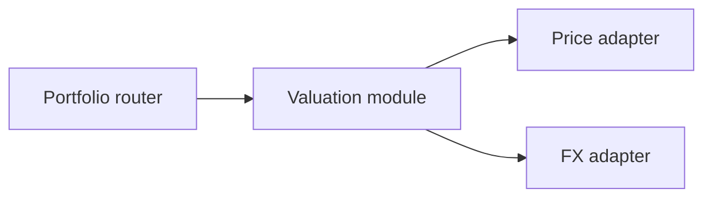

# Architecture Report Format

Write `docs/specs/NNN-name/architecture-review.md` for an existing feature, or propose a Draft feature spec and GitHub issue. Keep diagrams in Markdown; do not load remote scripts or assets.

## Header

Scope, date, feature and a compact legend: solid box = module, dashed arrow = seam, warning = leakage. Start with the candidates.

## Candidate section

The diagrams carry the weight. Prose is sparse and uses the vocabulary in `SKILL.md`.

For each candidate:

- **Title**: short, names the deepening (e.g. "Concentrate portfolio valuation").
- **Strength**: `Strong`, `Worth exploring` or `Speculative`.
- **Files**: paths and relevant line references.
- **Before / After diagram**: paired views of shallowness and proposed depth.
- **Problem**: one sentence with evidence.
- **Proposal**: what could change, without prematurely choosing interfaces.
- **Wins**: short bullets on locality, leverage and testability.
- **ADR conflict**: link an ADR only when observed friction warrants revisiting it.

No paragraphs of explanation. If the diagram needs a paragraph to be understood, redraw the diagram.

## Diagram patterns

Pick the pattern that fits the candidate. Mix them. Don't make every diagram look the same. Variety is part of the point.

### Mermaid graph (the workhorse for dependencies / call flow)

Use paired Mermaid `flowchart` or `sequenceDiagram` fences when relationships are graph-shaped. The Markdown renderer handles diagrams without instructions to fetch external assets.

### Text boxes-and-arrows (when Mermaid's layout fights you)

Use paired text diagrams or tables to make the "after" view one deep module with internal details hidden.

### Cross-section (good for layered shallowness)

Show a call's hops in a table. Before: many thin modules. After: one module with the consolidated responsibility.

### Mass diagram (good for "interface as wide as implementation")

Compare interface surface area and hidden implementation in a table. Before: nearly equal (shallow). After: small interface, larger implementation (deep).

### Call-graph collapse

Before: a tree of function calls rendered as nested boxes. After: the same tree collapsed into one box, with the now-internal calls shown faded inside it.

## Style guidance

- Keep the before/after views comparable and the prose short.
- Use a warning callout for observed leakage or a relevant ADR conflict.
- Keep all diagrams and evidence in the repository report without scripts or network resources.

## Top recommendation section

Candidate name, one sentence on why, and a link to its section. Ask Zack which candidate to explore.

## Tone

Plain English, concise, using the architectural nouns and verbs defined in `SKILL.md`.

**Use exactly:** module, interface, implementation, depth, deep, shallow, seam, adapter, leverage, locality.

Do not mistake Tallyhold's architectural **layers** for modules; layers still have their meaning in the product spec.

**Phrasings that fit the style:**

- "Portfolio valuation module is shallow: interface nearly matches the implementation."
- "Price lookup leaks across the seam."
- "Deepen: one interface, one place to test."
- "Two adapters justify the seam: HTTP in prod, in-memory in tests."

**Wins bullets** name the gain: *"locality: bugs concentrate in one module"*, *"leverage: one interface, N call sites"*, *"interface shrinks; implementation absorbs wrappers"*.

Keep the evidence separate from the proposal. A recommendation is not approval to implement.
