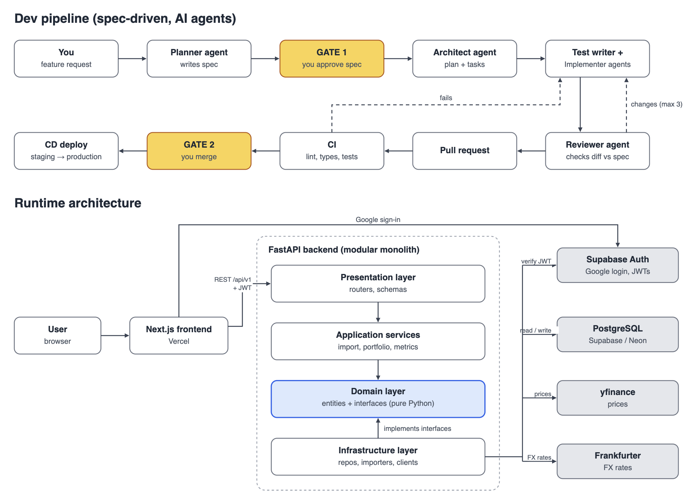

# Tallyhold

*All your brokers. One portfolio.*

Tallyhold gives long-term investors a consolidated portfolio view across broker accounts, with per-account drill-down. It is a multi-user learning project in OOP, SOLID, relational databases and spec-driven delivery.

**Status:** Phase 0: foundation.

Read the [product spec](docs/spec.md), [workflow](docs/workflow.md) and [agent entry point](AGENTS.md).
