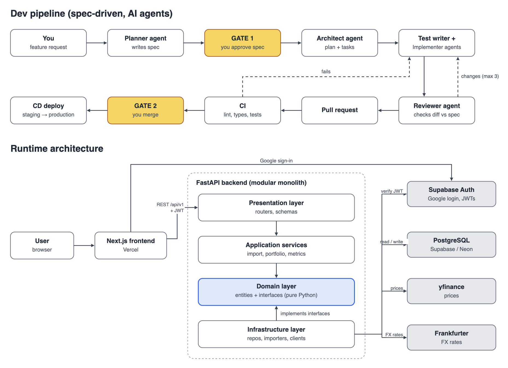

# Tallyhold

*All your brokers. One portfolio.*

Tallyhold gives long-term investors a consolidated portfolio view across broker accounts, with per-account drill-down. It is a multi-user learning project in OOP, SOLID, relational databases and spec-driven delivery.



**Status:** Phase 0: project scaffold.

Read the [product spec](docs/spec.md), [workflow](docs/workflow.md) and [agent entry point](AGENTS.md).

For current priorities, ticket ownership, and session recovery, start at
[work tracking](docs/work/README.md). The repo-local records include the
[roadmap](docs/work/roadmap.md) and agent run history; no external board is needed.

## Run locally

Install Python 3.12, [uv](https://docs.astral.sh/uv/), Node 24.19.0, npm and Docker Compose. The pins are in `backend/.python-version` and `frontend/.nvmrc`. The frontend runs on your host; Compose runs the API and disposable PostgreSQL only.

```sh
docker compose up --build -d
docker compose ps
curl --fail http://localhost:8000/api/v1/health
```

Then, in another terminal:

```sh
cd frontend
npm ci
npm run dev
```

Open http://localhost:3000 to see the API status. The frontend uses `http://localhost:8000` by default; override `NEXT_PUBLIC_API_URL` before starting Next.js if the API runs elsewhere. The API allows the local frontend origin `http://localhost:3000` by default (`FRONTEND_ORIGIN` overrides it). To stop the containers, use `docker compose down`.

### Google sign-in configuration

The public Next.js settings are illustrated in
[`frontend/.env.example`](frontend/.env.example): set
`NEXT_PUBLIC_SUPABASE_URL` and the project's **publishable** key in an
untracked `frontend/.env.local`, along with `NEXT_PUBLIC_API_URL` if needed.
Never use a service-role or secret key in `NEXT_PUBLIC_` variables. Configure
Google as an OAuth provider in Supabase Auth, enable PKCE and allow the exact
`http://localhost:3000/auth/callback` redirect for local development.

The trusted API settings are in [`backend/.env.example`](backend/.env.example).
Set `SUPABASE_JWT_ISSUER` to the exact project's
`https://<project>.supabase.co/auth/v1`,
`SUPABASE_JWT_AUDIENCE` to `authenticated`, and `SUPABASE_JWKS_URL` to the
same issuer plus `/.well-known/jwks.json`. When running Compose, export these
three variables into its environment before starting/recreating `api`;
Compose passes them through. For a native API process, provide them and a
PostgreSQL `DATABASE_URL` through its process environment. The verifier
requires HTTPS and only ES256/P-256; there is no JWT shared secret or HS256
fallback. Missing/invalid trusted settings fail closed on `/api/v1/me`, while
health remains public. `FRONTEND_ORIGINS` accepts comma-separated explicit
origins; do not include `*` or use the disposable local database for real users.
Run migrations before the first login.

Before admitting anyone other than Zack, follow the
[operator erasure runbook](docs/runbooks/erase-user.md): verify production Data
API OFF, provider backup/log retention, and the disposable end-to-end erasure
walkthrough. Those are deployment gates, not completed by local tests.

The local database is exposed on `127.0.0.1:55432`, not `5432`, to avoid common local Postgres conflicts. It uses trust authentication **only for disposable local development** and is not suitable for production or real user data. On a network with a custom trusted TLS authority, point `TALLYHOLD_CA_CERT` at its local PEM bundle when running `docker compose up --build -d`; Docker mounts it as a build secret, without committing the certificate or disabling TLS validation.

## Check changes

Run backend commands from `backend/`:

```sh
uv sync --locked --group dev
uv run --locked ruff check .
uv run --locked ruff format --check .
uv run --locked mypy app
uv run --locked lint-imports
TALLYHOLD_TEST_DATABASE_URL=postgresql+psycopg://tallyhold@127.0.0.1:55432/tallyhold_test \
  uv run --locked pytest --cov=app --cov-report=term-missing --cov-fail-under=80
```

The PostgreSQL integration suite requires the Compose `db` service (`docker
compose up -d db`). Its explicit local `tallyhold_test` URL is a **target
prefix**, not a database to migrate: pytest creates a unique
`tallyhold_test_<uuid>` database, migrates it, rolls back each test, and drops
it even on failure. It rejects the developer's `tallyhold` database and does
not use SQLite. Run the suite twice to verify clean reruns. For a separate
manual migration smoke check against a fresh disposable database:

```sh
docker compose exec -T db createdb -U tallyhold tallyhold_test_smoke
DATABASE_URL=postgresql+psycopg://tallyhold@127.0.0.1:55432/tallyhold_test_smoke \
  uv run --locked alembic upgrade head
DATABASE_URL=postgresql+psycopg://tallyhold@127.0.0.1:55432/tallyhold_test_smoke \
  uv run --locked alembic downgrade base
docker compose exec -T db dropdb -U tallyhold tallyhold_test_smoke
```

Run these commands from `backend/`. `createdb` fails if the named smoke
database already exists; inspect it before dropping any existing database.
CI's integration suite uses uniquely named disposable databases and its
upgrade/downgrade smoke check uses the separate fresh service database.

For unit-only checks without PostgreSQL, exclude `tests/integration`:

```sh
uv run --locked pytest tests/domain
```

Run frontend commands from `frontend/`:

```sh
npm ci
npm run lint
npm run format:check
npm run typecheck
npm test
npm run build
npm audit --omit=dev --audit-level=high
```

The backend dependency scan checks the full locked dependency graph:

```sh
uv export --locked --all-groups --no-emit-project --format requirements-txt --output-file /tmp/tallyhold-requirements.txt >/dev/null
uv run --locked pip-audit -r /tmp/tallyhold-requirements.txt
```

Run `gitleaks git --redact --exit-code 1 .` at the repository root for the secret scan. CI runs these checks and the migration round-trip against a fresh PostgreSQL service on every pull request.

## Production database migrations

On each push to `main`, CI runs the backend, frontend and security checks
first. Only if all three pass does the `production-migrations` job wait for
Zack's approval through the GitHub `production` environment. The workflow can
also be started with **Run workflow** (`workflow_dispatch`) on `main`; it
performs the same checks and requires the same approval. A manual run on
another branch does not run the production job.

Once approved, the job runs `alembic upgrade head` from `backend/` using
`DATABASE_URL` sourced from the `SUPABASE_DATABASE_URL` GitHub Actions secret.
Configure that secret with the production PostgreSQL connection URL without
committing or printing it. The URL must use the installed psycopg driver
(`postgresql+psycopg://...`). The production job never downgrades, deploys the
API or consumes other secrets. CI's upgrade/downgrade smoke test uses only its
disposable local PostgreSQL service, not Supabase.

Keep Supabase's own **Deploy to production** integration **OFF**: Alembic is
the only tool that applies Tallyhold schema migrations. Confirm the GitHub
`production` environment requires Zack's review before enabling this job;
an unprotected environment would not provide the required approval gate.
