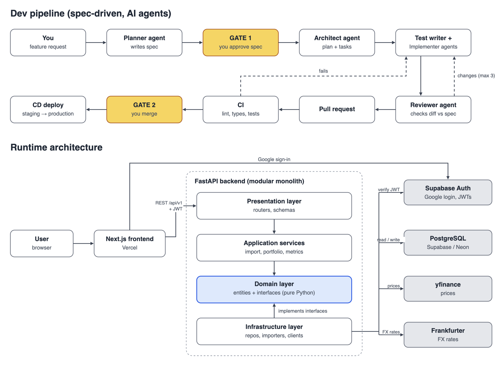

# Tallyhold — Spec v0.1

*All your brokers. One portfolio.*

Last updated: 2026-11-12 · Owner: Zack

## Overview

A multi-user web app that gives long-term investors one view of their portfolio across every broker, with drill-down into each broker account. It is built as a learning project in OOP, SOLID, relational database design and end-to-end delivery, with code written by an AI agent team under spec-driven development.

**Target user:** a long-term, buy-and-hold investor with holdings spread across several brokers (e.g. Tiger, IBKR). Not a trader.

**Goals**

- One consolidated overview across all brokers, in the user's chosen base currency
- Drill-down per broker account
- Any market, any currency, any asset type over time, without rewriting existing code
- A clean, uncluttered dashboard: few metrics, the right ones

**Non-goals (for now)**

- Real-time prices, alerts or notifications
- Options and other derivatives
- Trade execution of any kind: the app is read-only towards brokers
- Tax reporting

## Scope

The MVP covers US stocks and ETFs, entered by CSV upload or by hand. Everything else is designed for but built later.

| Area | MVP | Later (designed for now) |
| --- | --- | --- |
| Users | Google login, multi-user from day 1 | More providers (Telegram, email), account linking |
| Markets | US (NYSE, NASDAQ) | SGX, HKEX, any exchange |
| Asset types | Stocks, ETFs | SSBs, T-bills, bonds, options, manually valued assets |
| Currencies | Any currency stored; hardcoded FX rates | Live rates from Frankfurter |
| Data entry | Canonical CSV import, manual entry, bulk edit/delete | Broker-specific importers, IBKR Flex sync, Tiger OpenAPI |
| Quantities | Whole shares in the UI; decimal in the DB | Fractional shares |
| Selling | Whole-position sells | Partial sells with selectable cost basis method |
| Corporate actions | Manual SPLIT entry | Auto-detected splits |
| Dividends | DIVIDEND transaction, total received | Dividend calendar, withholding tax breakdown |
| Cash | Not tracked | DEPOSIT / WITHDRAWAL, cash balances |
| Dashboard | 5 core metrics, overview + per-broker | Value-over-time chart, XIRR, benchmark comparison |

## Architecture style

The backend is a **modular monolith** with a **layered (clean) architecture**, exposed as a REST API to a separate frontend. One deployable backend, cleanly divided inside.



Arrows show who calls whom. Infrastructure points up because it implements interfaces the domain defines: that is dependency inversion.

**Why not microservices:** they solve team-scaling problems (many teams deploying independently) by adding network calls, distributed data and deployment overhead. One developer with an agent team gains nothing from that. Clean module boundaries keep the option open: a module can be split out later if it ever needs to scale alone.

**Why not classic MVC:** MVC is a pattern for the presentation layer, where the server renders pages. Here the frontend (Next.js) renders the UI and the backend only serves JSON. MVC's ideas still appear: FastAPI routers act as controllers, Pydantic schemas as views of the data, and the domain layer as the model.

**Layers** (each depends only on the layer below it, and on interfaces rather than concrete classes):

1. **Presentation:** Next.js frontend; FastAPI routers and Pydantic request/response schemas. No business logic.
2. **Application (services):** use cases such as `ImportService`, `PortfolioService`, `ValuationService`, `MetricsService`. Orchestrates the domain and repositories.
3. **Domain:** entities (`Transaction`, `Instrument`, `Position`, `BrokerAccount`) and interfaces (`Importer`, `PriceProvider`, `FxRateProvider`, `Metric`, `CostBasisMethod`, `ValuationStrategy`). Pure Python, no framework or DB imports, fully unit-testable.
4. **Infrastructure:** SQLAlchemy repositories, Alembic migrations, CSV importers, yfinance and Frankfurter clients, Supabase auth verification.

**Modules** (vertical slices inside the monolith): `identity`, `accounts`, `instruments`, `transactions`, `importing`, `market_data` (prices, FX), `portfolio` (positions, valuation, metrics).

The principles this enforces: dependency inversion (services depend on interfaces), open/closed (new brokers, metrics and asset types are new classes), single responsibility (one class, one job), and the repository pattern (the domain never knows about SQL).

## Tech stack and hosting

Every piece starts on a free tier; free-tier limits should be checked when setting up, since they change.

| Layer | Choice | Hosting |
| --- | --- | --- |
| Frontend | Next.js (TypeScript), Tailwind, a chart library (e.g. Recharts) | Vercel |
| Backend API | Python 3.12, FastAPI, Pydantic | Render, Fly.io or Google Cloud Run |
| ORM and migrations | SQLAlchemy 2.x, Alembic | n/a |
| Database | PostgreSQL (SQLite allowed for local unit tests only) | Supabase or Neon |
| Auth | Supabase Auth with Google sign-in | Supabase |
| Prices | yfinance behind `PriceProvider` (unofficial, may break) | n/a |
| FX rates | Hardcoded now; Frankfurter (api.frankfurter.dev, free, no key) later | n/a |
| Local dev | Docker Compose: API + Postgres | Laptop |
| CI/CD | GitHub Actions | GitHub |
| Code quality | uv, ruff (lint, format), mypy (types), pytest + coverage; ESLint, Prettier for the frontend | n/a |

The repo is a monorepo: `/backend`, `/frontend`, `/docs` (spec, constitution, ADRs, agent roles, feature specs), `/.github`, plus thin tool-specific wrappers (`CLAUDE.md`, `.claude/`, `.trae/`).

## Auth and multi-user design

Users are identified by an internal UUID, never by an email or username, so a changed email or Telegram handle never breaks an account.

- **Login:** Supabase Auth handles Google sign-in and issues a JWT. The frontend sends it with each request; FastAPI verifies it and resolves the internal user.
- **Identity linking:** each login provider gives a permanent subject ID (Google's `sub`, Telegram's numeric user ID). The `identities` table maps `(provider, provider_subject)` to a `user_id`, so one user can link several providers and new providers are just new rows.
- **Data isolation:** every user-owned table carries `user_id`. Repositories always filter by the current user; Postgres Row Level Security is a second line of defence.
- **Secrets:** API keys and DB credentials live in environment variables and GitHub/hosting secrets, never in the repo. Agents never read or write secrets.
- **Scaling:** stateless API instances behind JWT auth scale horizontally; indexes on `user_id` and `(user_id, broker_account_id)` keep per-user queries fast.

## Domain model and extensibility points

Transactions are the single source of truth; positions, values and metrics are always derived from them, never stored as editable data. Every axis the app must grow along sits behind an interface, so growth means adding a class.

| Extension point | Interface | MVP implementation | Added later |
| --- | --- | --- | --- |
| Asset types | `Instrument` (abstract) | `Stock`, `ETF` | `Bond`, `SSB`, `TBill`, `Option`, `ManualAsset` |
| How an asset is valued | `ValuationStrategy` | `MarketPriceValuation` | `FixedIncomeValuation`, `ManualValuation` |
| Data sources | `Importer` | `CanonicalCsvImporter`, manual entry | `TigerCsvImporter`, `IbkrCsvImporter`, `IbkrFlexImporter`, `TigerApiImporter` |
| Prices | `PriceProvider` | `YFinancePriceProvider` | Paid feeds, SGX-specific sources |
| FX | `FxRateProvider` | `HardcodedFxProvider` | `FrankfurterFxProvider` |
| Ticker formats | `SymbolMapper` (per price provider) | US tickers as-is | SGX `D05` → `D05.SI` |
| Cost basis | `CostBasisMethod` | `AverageCost` | `Fifo`, user-selectable |
| Metrics | `Metric` | 5 core metrics | XIRR, benchmark comparison, value over time |

**Core entities:** `User`, `BrokerAccount` (a user's account at one broker, with its currency), `Exchange`, `Instrument`, `Transaction` (BUY, SELL, DIVIDEND, SPLIT now; FEE, DEPOSIT, WITHDRAWAL later), `Position` (derived), `PriceQuote`, `FxRate`.

**Rules the agents must follow:**

- Money and quantities use `Decimal`, never `float`; every money value carries its currency.
- Services depend on interfaces and receive implementations by dependency injection (FastAPI `Depends` or a small container).
- The domain layer imports nothing from FastAPI, SQLAlchemy or any HTTP library.
- New implementations are registered in one place (a registry or factory), not by editing services.

## Database schema

Ten tables in third normal form; positions are computed, not stored. All IDs are UUIDs, all timestamps UTC, all money `NUMERIC(20,6)`, all quantities `NUMERIC(18,8)`.

| Table | Key columns | Notes |
| --- | --- | --- |
| `users` | `id` PK, `display_name`, `base_currency`, `cost_basis_method`, `created_at` | Base currency and cost basis method are user settings |
| `identities` | `id` PK, `user_id` FK, `provider`, `provider_subject`, `email` | UNIQUE(`provider`, `provider_subject`); email is informational only |
| `brokers` | `id` PK, `name`, `country` | Reference data: Tiger, IBKR, Moomoo… |
| `broker_accounts` | `id` PK, `user_id` FK, `broker_id` FK, `nickname`, `base_currency` | One user can hold several accounts at one broker |
| `exchanges` | `code` PK (e.g. `NASDAQ`, `SGX`), `name`, `currency`, `timezone` | Reference data |
| `instruments` | `id` PK, `symbol`, `exchange_code` FK, `instrument_type`, `currency`, `name`, `attributes` JSONB | UNIQUE(`symbol`, `exchange_code`); `attributes` holds type-specific fields (coupon, maturity, strike) |
| `transactions` | `id` PK, `user_id` FK, `broker_account_id` FK, `instrument_id` FK, `type`, `trade_date`, `quantity`, `price`, `fees`, `amount`, `tax_withheld`, `currency`, `split_ratio`, `source`, `import_batch_id` FK, `dedupe_hash` | `type` is an enum; UNIQUE(`user_id`, `dedupe_hash`) blocks duplicate imports |
| `import_batches` | `id` PK, `user_id` FK, `filename`, `importer`, `status`, `row_count`, `created_at` | Lets a whole bad import be rolled back in one action |
| `price_quotes` | `instrument_id` FK, `quote_date`, `close`, `currency`, `source` | PK(`instrument_id`, `quote_date`); shared across users |
| `fx_rates` | `base`, `quote`, `rate_date`, `rate`, `source` | PK(`base`, `quote`, `rate_date`) |

The instrument type uses single-table inheritance (one `instruments` table, an `instrument_type` discriminator, a JSONB column for extra fields). If an asset type grows many fields of its own, it moves to its own table joined on `instrument_id`. Every schema change goes through an Alembic migration reviewed at Gate 2.

## Data import and bulk edits

The MVP imports one canonical CSV format that the app defines; broker-specific importers that convert each broker's export into it come later, once sample exports are available.

```csv
trade_date,broker_account,symbol,exchange,type,quantity,price,amount,fees,tax_withheld,split_ratio,currency
2026-03-02,Tiger Main,AAPL,NASDAQ,BUY,10,182.50,,1.99,,,USD
2026-05-15,Tiger Main,AAPL,NASDAQ,DIVIDEND,,,2.40,,0.72,,USD
2026-06-10,IBKR,NVDA,NASDAQ,SPLIT,,,,,,10,USD
```

Required columns depend on `type`: BUY and SELL need quantity and price; DIVIDEND needs `amount` (gross) and optionally `tax_withheld`; SPLIT needs `split_ratio` (new shares per old share).

**Import flow:**

1. Upload the file; the app parses it with the chosen `Importer`.
2. Validate each row (known symbol, valid date, required fields per type).
3. Show a preview: rows to add, rows flagged as duplicates, rows with errors.
4. The user confirms; rows are saved in one database transaction under an `import_batch`.
5. A batch can be undone as a whole.

**Duplicate detection:** each row gets a `dedupe_hash` from (account, date, symbol, type, quantity, price). Re-uploading the same file adds nothing.

**Bulk edits:** an editable transactions table with multi-select edit and delete, filters by account, symbol and date range, and re-import of a corrected CSV.

## Calculation rules and MVP metrics

The dashboard shows five metrics, each computable for the whole portfolio or one broker account: total value, total invested, unrealised gain/loss, allocation, and dividends received. Each rule below is derived before it is stated.

**Currency conversion.** A value in the instrument's currency is worth the same number of local units times the price of one local unit in base units. If 1 USD buys 1.30 SGD, USD 1,000 is 1,000 × 1.30 = SGD 1,300. All metrics convert at the same date's rate.

```math
V_{base} = V_{local} \times r_{local \to base}
```

**Total invested (cost basis, average cost method).** Each buy costs its shares times price, plus fees. Adding every buy gives what the user paid in. Spreading that over the shares held gives the average cost per share. Example: 10 at $100 + $1 fee and 10 at $120 + $1 fee → C = 1,001 + 1,201 = $2,202, and $2,202 / 20 = $110.10 per share.

```math
C = \sum_i (q_i \, p_i + f_i) \qquad \bar{c} = \frac{C}{Q}
```

**Total value.** What the holding would fetch today is shares held times today's closing price: 20 × $130 = $2,600.

```math
MV = Q \times P_{close}
```

**Unrealised gain/loss.** The gain is what selling now would return minus what was paid in; the percentage compares that gain to the money put in: $2,600 − $2,202 = $398, and $398 / $2,202 = 18.1%.

```math
PL = MV - C \qquad PL\% = \frac{MV - C}{C}
```

**Allocation.** A group's share of the portfolio is its value divided by the total value, grouped by broker account, asset type or currency. The shares add up to 100%.

```math
w_g = \frac{MV_g}{\sum_k MV_k}
```

**Dividends received.** The user keeps the gross dividend minus the tax withheld at source (US dividends are withheld at 30% for Singapore residents). Shown year-to-date and all-time, net.

```math
D_{net} = D_{gross} - T_{withheld}
```

**Stock splits.** A split gives more shares but the same total cost: in a 10-for-1 split, 10 shares become 100, the $2,202 paid stays $2,202, so average cost falls tenfold. Without this rule the app would multiply the old share count by the new, split-adjusted price and show a false 90% loss.

```math
Q_{new} = Q \times k \qquad C_{new} = C \qquad \bar{c}_{new} = \frac{\bar{c}}{k}
```

**Sells (MVP).** A SELL closes the whole position. Partial sells are later work: they need the cost basis method (average cost by default, FIFO selectable), which is why it is already a user setting.

## API and UI structure

The API is versioned REST under `/api/v1`, and every endpoint is scoped to the logged-in user.

| Endpoint | Purpose |
| --- | --- |
| `GET /me`, `PATCH /me` | Profile, base currency, cost basis method |
| `GET/POST/PATCH/DELETE /accounts` | Broker accounts |
| `GET /instruments?query=` | Search or create instruments |
| `GET/POST/PATCH/DELETE /transactions` | List with filters; manual entry; edits |
| `POST /transactions/bulk` | Bulk edit or delete |
| `POST /imports/preview`, `POST /imports/{id}/confirm`, `DELETE /imports/{id}` | Two-step import and undo |
| `GET /portfolio/summary?account_id=` | The five metrics; omit `account_id` for the whole portfolio |
| `GET /portfolio/positions?account_id=` | Derived holdings |

**Pages:**

1. **Overview:** the five metrics across all brokers, an allocation chart, and a holdings table.
2. **Account view:** the same layout filtered to one broker account, reached by clicking an account.
3. **Transactions:** an editable, filterable table with bulk actions.
4. **Import:** upload, preview, confirm, and import history with undo.
5. **Settings:** base currency, cost basis method, linked logins, broker accounts.

## AI agent workflow: spec-driven development

The build follows spec-driven development (SDD): a written, approved spec is the source of truth, and agents generate code, tests and reviews from it rather than from loose chat prompts. Zack approves at two gates; agents do everything between them.

**Tools:** two tools work on this repo — Trae (GPT) on one device and Claude Code CLI on another. Rules and agent roles are written once in tool-neutral files; each tool gets a thin wrapper:

- `AGENTS.md`: the single entry point every agent reads first.
- `CLAUDE.md`: one line, `@AGENTS.md`.
- `.trae/rules/project_rules.md`: points Trae at `AGENTS.md` and `docs/constitution.md`.
- `docs/agents/*.md`: one file per role; Claude Code wrappers in `.claude/agents/`, Trae custom agents pasted from the same text.

Suggested split: Claude Code for Planner, Architect and Reviewer; Trae for Test writer and Implementer, so a different model reviews the code than the one that wrote it.

**Two-device rules:** Git is the only sync. Pull before starting, push when stopping. One feature = one branch = one tool at a time.

**Document hierarchy** (all in `/docs`, versioned in Git):

- `constitution.md`: the rules every agent obeys (architecture, layering, Decimal for money, test coverage floor, naming, no secrets).
- `spec.md` (this file): product and architecture source of truth.
- `adr/NNNN-*.md`: architecture decision records, one per significant decision.
- `specs/NNN-feature/`: per feature, a `spec.md` (what and acceptance criteria), `plan.md` (how: files, classes, migrations) and `tasks.md` (ordered, small tasks).

**Agent roles:**

| Agent | Responsibility | Produces | May not |
| --- | --- | --- | --- |
| Planner | Turns a feature request into `spec.md` with testable acceptance criteria | Feature spec | Write code |
| Architect | Turns an approved spec into `plan.md`; checks layering, SOLID and schema | Plan, ADRs, migrations design | Write feature code |
| Test writer | Writes failing pytest tests from the acceptance criteria | Tests | Change production code |
| Implementer | Makes the tests pass, task by task, on a feature branch | Code, Alembic migrations | Edit tests to make them pass, push to `main` |
| Reviewer | Reviews the diff against spec, plan, constitution and security | Review report, change requests | Approve its own changes |
| DevOps | Maintains CI/CD and environments | GitHub Actions, Dockerfiles | Touch secrets |

**Flow for one feature:**

1. Zack writes a feature request as a GitHub issue.
2. Planner drafts `spec.md`.
3. **Gate 1:** Zack approves the spec (and the plan for anything touching schema or architecture).
4. Architect writes `plan.md` and `tasks.md`.
5. Test writer commits failing tests on `feature/NNN-name`.
6. Implementer works through `tasks.md` until the tests pass, committing with Conventional Commit messages.
7. Reviewer checks the diff; change requests go back to step 6, at most 3 rounds before escalating to Zack.
8. An agent opens a pull request linking the issue and spec.
9. CI runs; a failure goes back to step 6.
10. **Gate 2:** Zack reviews and merges.
11. CD deploys to staging; production deploy on a tagged release.

**CI checks on every pull request:** ruff lint and format check, mypy, pytest with a coverage floor (80% to start, higher for the domain layer), Alembic migration check against a fresh Postgres, frontend lint, type check and build, and a dependency vulnerability scan.

**Repository guardrails:** `main` is not branch-protected on GitHub for now, so the rules are enforced by the constitution and agent instructions: agents work only on feature branches, never push to or merge into `main`, and never touch secrets. Only Zack merges. Branch protection can be turned on later without changing the workflow.

## Build phases

Each phase ends with a deployable app; each feature inside it goes through the two-gate flow above.

1. **Phase 0, foundations:** constitution, `AGENTS.md`, agent role files, spec templates, then feature 001 (backend and frontend skeletons, Docker Compose, CI). Done when a pull request with a trivial change passes CI.
2. **Phase 1, core domain:** domain entities and interfaces, schema and migrations, average cost calculator, unit tests for every formula in this spec. No UI yet.
3. **Phase 2, auth and accounts:** Google login via Supabase, `identities`, broker account CRUD.
4. **Phase 3, transactions and import:** manual entry, canonical CSV import with preview, dedupe and undo, bulk edit.
5. **Phase 4, dashboard MVP:** yfinance prices, hardcoded FX, the five metrics, overview and per-account pages, first deploy. First real use.
6. **Phase 5, expansion:** value-over-time chart, Frankfurter FX, SGX support, broker-specific importers, partial sells with FIFO option, XIRR.
7. **Phase 6+:** fixed income (SSBs, T-bills), IBKR Flex sync, options.

## Decisions log

- Product and repo name: **Tallyhold** (`donkey-king-kong/tallyhold`).
- Agent tools: Trae (GPT) and Claude Code CLI, with tool-neutral rules in `AGENTS.md`.
- No GitHub branch protection for now; enforced by the constitution.

## Open questions

- [ ] Coverage floor: is 80% right to start?
- [ ] Sample Tiger and IBKR CSV exports (on hold), needed before Phase 5 importers
- [ ] Which free host to commit to for the API (Render, Fly.io or Cloud Run)
