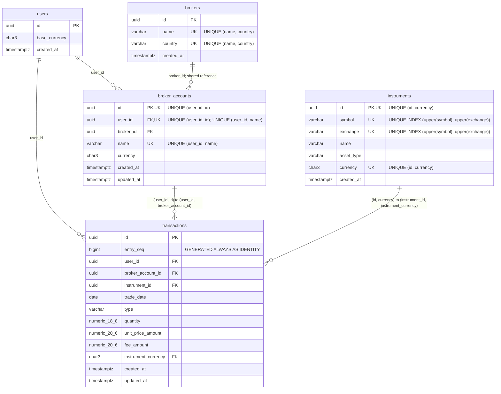

# 003: Schema and repositories architecture plan

## Status and gate

- [Spec](spec.md): Gate 1 approved 2026-11-13; RLS deferred to auth/accounts.
- Architecture Q1 resolved: Feature 002's approved five repository ports merged
  through PR #21 (`272d0a9`); see its
  [contract](../002-core-domain/spec.md) and
  [interfaces](../../../backend/app/modules/transactions/domain/repositories.py).
- **Proposed; Zack's schema/architecture-plan approval required.** This file
  and [tasks](tasks.md) authorize no tests, migrations or implementation yet.
  Issue [#17](https://github.com/donkey-king-kong/tallyhold/issues/17).

## Persistence boundary

Persist the five non-derived Feature 002 entities: `User`, `Broker`,
`Account`, `Instrument`, `Transaction`. `Money` is stored as amount plus
currency, not an entity; `Position`, `RealisedResult`, strategy outputs and
metrics are computed, never tables. Repositories implement the five existing
domain ABCs without changing their methods, signatures or domain behavior.

Feature 002 has no `Identity`, `Exchange`, `ImportBatch`, `PriceQuote` or
`FxRate` entity or repository port. Therefore this incremental migration
creates **five tables**, not the product spec's eventual ten. In particular,
`Instrument.exchange` remains a required market code string with no exchange
FK or seed-data dependency; its `(symbol, exchange)` identity is unique.
Identity linking, exchange metadata, imports, quotes, FX and the product's
additional `User`/transaction settings require later approved contracts and
migrations. This deliberate interim difference from
[product schema](../../spec.md#database-schema) is part of Zack's plan gate.

| Layer and files (planned) | Responsibility |
| --- | --- |
| `backend/app/shared/infrastructure/database.py` | Common SQLAlchemy 2.x declarative `Base`/metadata only; no business-module imports or application wiring. |
| `backend/app/modules/identity/infrastructure/{models,repositories}.py` | `UserRow` and `UserRepository` adapter; map `User.id` and base currency. |
| `backend/app/modules/accounts/infrastructure/{models,repositories}.py` | `BrokerRow`, `AccountRow` and the two account-module adapters. |
| `backend/app/modules/instruments/infrastructure/{models,repositories}.py` | `InstrumentRow` and shared-reference adapter. |
| `backend/app/modules/transactions/infrastructure/{models,repositories}.py` | `TransactionRow`, `TransactionType`/`Money` mapper and scoped adapter. |
| `backend/alembic/env.py`, `backend/alembic/versions/0002_core_persistence.py` | Import all model modules into `Base.metadata`; create and reverse schema after empty `0001_baseline`. Alembic imports infrastructure; business modules do not import one another. |
| `backend/tests/integration/{conftest,test_migrations,test_repositories,test_isolation}.py` | Migrated disposable PostgreSQL databases, repository contract tests, raw-SQL constraint checks and cleanup. |
| `backend/pyproject.toml`, `.github/workflows/ci.yml`, `README.md` | Integration markers/CI invocation and exact local Compose test instructions, only as needed after approval. |

Use SQLAlchemy mapped row classes rather than mapping frozen domain dataclasses
in place. Each adapter accepts an injected SQLAlchemy `Session`, translates
between rows and its own module's public domain objects, and returns no ORM
instance. `TransactionRow` stores `quantity`, `unit_price_amount`, `fee_amount`
and `instrument_currency`; hydration constructs `Money(amount, currency)` for
price and fee and the `TransactionType` enum. No implicit exchange lookup or
other business-module import is needed to hydrate an entity. Domain imports
remain pure; database mappings and error handling remain infrastructure-only.

## Relational design and Architecture Q2

All five tables are created by one additive revision after the empty baseline.
Use UUID PKs and PostgreSQL-native `UUID`, `DATE`, exact `NUMERIC` and bounded
`VARCHAR`; required columns are `NOT NULL`. Define stable constraint names
for catalog assertions and future migrations. Application supplies UUIDs; no
hidden identity generation changes the domain contract.

| Table | Columns, keys and checks | Relationships and access indexes |
| --- | --- | --- |
| `users` | `id` UUID PK, `base_currency` CHAR(3) NOT NULL | Root identity: `id` itself is the tenant identifier, not a second redundant `user_id`. No cross-user lookup is exposed by `UserRepository.get(user_id)`. |
| `brokers` | `id` UUID PK, `name` and `country` NOT NULL; **UNIQUE (`name`, `country`)** | Shared reference; no `user_id`. Uniqueness prevents duplicate seeds such as two "Tiger/SG" rows. |
| `broker_accounts` | `id` UUID PK, `user_id` UUID NOT NULL, `broker_id` UUID NOT NULL, `name` NOT NULL, `currency` CHAR(3) NOT NULL; UNIQUE (`user_id`, `id`) for tenant composite FK; **UNIQUE (`user_id`, `name`)** | FK `user_id -> users.id`, FK `broker_id -> brokers.id`; index (`user_id`, `id`) supplied by UNIQUE for get/list and FK. Per-user name uniqueness is required because the canonical CSV maps rows by account name ([product spec](../../spec.md#data-import-and-bulk-edits)); adding it after duplicates exist would fail. |
| `instruments` | `id` UUID PK, `symbol`, `exchange`, `name`, `asset_type` NOT NULL, `currency` CHAR(3) NOT NULL; **UNIQUE index on (`upper(symbol)`, `upper(exchange)`)** replacing a case-sensitive UNIQUE; UNIQUE (`id`, `currency`) | Shared reference; second candidate key enables transaction currency FK. No `user_id`. No JSONB attribute bag or type discriminator beyond the 002 `asset_type` string. Stored values keep their original case; `find_by_symbol` matches case-insensitively, consistent with the index. |
| `transactions` | `id` UUID PK; **`entry_seq` BIGINT GENERATED ALWAYS AS IDENTITY (DB-only, not in domain)**; `user_id`, `broker_account_id`, `instrument_id` UUID NOT NULL; `trade_date` DATE, `type` VARCHAR, `quantity` NUMERIC(18,8), `unit_price_amount` and `fee_amount` NUMERIC(20,6), `instrument_currency` CHAR(3), all NOT NULL; CHECK type IN (`BUY`, `SELL`), quantity > 0, price > 0, fee >= 0 | FK `user_id -> users.id`; **composite FK (`user_id`, `broker_account_id`) -> `broker_accounts` (`user_id`, `id`)**; composite FK (`instrument_id`, `instrument_currency`) -> `instruments` (`id`, `currency`); index (`user_id`, `broker_account_id`, `trade_date`, `entry_seq`) for list; index (`user_id`, `id`) for scoped get/delete. |

`UK` marks participation in the **composite** unique keys or expression index
named beside the columns; it does not mean each participating column is
individually unique. A parent can have zero or more child rows. All FKs use
`ON DELETE NO ACTION`. No positions or P&L table is persisted.

**Audit columns (all tables):** `created_at TIMESTAMPTZ NOT NULL DEFAULT now()`;
`broker_accounts` and `transactions` also get `updated_at TIMESTAMPTZ NOT NULL
DEFAULT now()`, set by the adapter on update. Server-side only; not part of
the domain entities. Backfilling these later would be lossy.

**Delete semantics:** every FK uses `ON DELETE NO ACTION` (checked at statement
end, not immediately as `RESTRICT` is), so a future single-statement user
erasure can add cascades without tripping on the account FK. Deleting an account
that still has transactions fails. User deletion is **unsupported in 003**: no
domain port exists for it. Cascade/erasure (PDPA) is decided in the
auth/accounts phase.

Currency columns have a CHECK for exactly three uppercase ASCII letters
(PostgreSQL `COLLATE "C"` or an equivalent ASCII-only expression), matching
the domain's normalized currency contract. Symbol/exchange/name strings are
not silently case-folded; the approved domain preserves them. A currency
change to a referenced instrument is restricted by its composite FK; a later
business rule for symbol/currency correction needs a separate contract.
Retain database CHECKs even when domain constructors already reject bad trades,
because direct SQL and bulk paths must obey the same persisted invariants.
No `amount`, `tax_withheld`, `split_ratio`, dedupe hash or import-batch FK is
added before its domain contract exists.

The transaction/account composite FK is the **database-level tenant boundary**:
a row for user A cannot point at an account owned by user B even when both UUIDs
exist. A simple account-id FK plus independent user FKs would not ensure this.
The child `user_id` is NOT NULL, so the composite FK cannot be evaded through
nulls. The `UNIQUE (user_id, id)` candidate key is necessary even though `id`
is already the PK. Shared broker/instrument FKs intentionally do not constrain
tenant ownership. For any future user-owned FK, repeat the composite-key rule.
This is relational integrity, **not RLS**: direct SQL can still read user rows;
authenticated isolation and RLS belong to a later phase.

PostgreSQL `NUMERIC(20,6)` and `NUMERIC(18,8)` follow the product spec, but
Feature 002 `Decimal` accepts arbitrarily fine values. Adapters must **reject**
out-of-range or over-scale values before SQLAlchemy/PostgreSQL can silently
round them; no quantization, float conversion or truncation. Test exact
round trips at allowed limits and rejection for excess precision. Persist
`TransactionType` as its stable string value with a CHECK rather than relying
on a mutable PostgreSQL enum. Price and fee share the one explicit transaction
currency; the instrument composite FK prevents mismatched persisted currency.

## Repository behavior and transaction ownership

- `UserRepository`: `get(user_id)` and `save(user)` use the root ID.
  `BrokerRepository`: `get`, `list_all`, `save`. `InstrumentRepository`:
  `get`, `find_by_symbol(symbol, exchange)`, `save`. These shared references
  have no fabricated tenant scope.
- `AccountRepository`: every `get`, `list_for_user`, `save`, `delete` SQL
  predicate includes `user_id`. `save(user_id, account)` rejects an owner
  mismatch before writing; an existing ID held by another user is never
  updated. An absent/foreign scoped delete has no effect.
- `TransactionRepository`: `get`, `list_for_account`, `save`, `delete` include
  `user_id`; `list_for_account` includes `broker_account_id` and returns a
  deterministic `(trade_date, entry_seq)` order, which is the supplied order
  consumed by Feature 002 calculations on same-date trades. UUID ordering
  would let a same-day SELL sort before its BUY and make `AverageCostStrategy`
  raise `cannot sell without an open position`. 002 sorts by `trade_date`
  only and relies on a stable sort, so this order is load-bearing.
  `entry_seq` is never written by the adapter: it is excluded from the
  insert/upsert column lists (`GENERATED ALWAYS` rejects explicit values) and
  mapped as server-generated. Replace-save must use UPDATE or `ON CONFLICT DO
  UPDATE`, never delete+insert, so the sequence is preserved. Saving mismatched owner
  fails before writing; a foreign ID is never modified or returned. Account
  existence/ownership is enforced by the composite FK even if a caller
  bypasses pre-validation.
- `save` may insert or replace stored fields for the same owned ID, matching
  the ABC's operation while returning no value. User-owned tables use
  `INSERT ... ON CONFLICT (id) DO UPDATE SET ... WHERE <table>.user_id =
  EXCLUDED.user_id`, then check the affected row count: 0 means the ID belongs
  to another user, so raise one generic error that reveals nothing and changes
  nothing. Resolve uniqueness/FK/CHECK failures through PostgreSQL, not
  fabricated domain ports. **Error translation:** adapters catch
  `sqlalchemy.exc.IntegrityError` and raise a single infrastructure
  `PersistenceConstraintError` (carrying the constraint name), so callers never
  depend on driver exceptions. Apply this consistently across all five
  adapters.
- Shared `brokers`/`instruments` are writable through `save` by any caller
  until auth exists. Revisit write authority in the auth phase.
- Repositories `flush` writes to surface constraint errors and **never
  commit**. The caller owns `session.begin()`/rollback for atomic multi-row
  work; after any flush error the caller rolls back the failed transaction
  before reuse. Integration tests prove no partial commit. No application
  service, FastAPI dependency registration or auth context is introduced here.
  Until auth exists, user ID is supplied explicitly to the domain interface;
  these adapters do not infer identity from a request or set RLS session vars.

## Migrations and real PostgreSQL verification

`0001_baseline` stays unchanged and empty. Revision `0002_core_persistence`
creates `users`, `brokers`, `instruments`, `broker_accounts`, `transactions`
in FK-safe order with explicit indexes/constraints; `downgrade()` drops them
in reverse dependency order. Set Alembic `target_metadata` to the common Base
after importing each model module. No `create_all()` in production or tests.
Migration failure diagnostics identify direction and revision.

The integration fixture requires the repository's Docker Compose PostgreSQL 17
`db` service locally (`127.0.0.1:55432`), with the CI PostgreSQL 17 service
using the same engine and migrations. Create a **uniquely named disposable
database per test run** from an explicit test DB URL; migrate it before
repository tests, isolate each test with rollback, and drop it at teardown
even after failure. Never touch the developer's `tallyhold` database or any
live URL. Fail loudly (rather than substitute SQLite or silently skip) when
the integration suite is requested without PostgreSQL. CI must supply a
disposable database target; local instructions show starting the Compose DB.

In a separate fresh disposable database, assert:

1. `base -> 0001_baseline -> head (0002)` succeeds and catalog inspection
   finds five tables, types, composite FKs, uniqueness, checks and indexes;
   no authoritative `positions` table.
2. `head -> 0001_baseline` removes Feature 003 tables, then
   `0001_baseline -> head` recreates the same schema as a clean head upgrade
   (normalized catalog comparison, not just command exit status).
3. Test cross-user account FK rejection by direct SQL, not just repository
   prechecks; test price/fee checks, currency FK, uniqueness, exact Decimal
   round trips, FK failures, scoped CRUD, shared reference access, rollback
   after a failed flush and clean reruns.
4. Ordering: a same-date BUY then SELL lists in insertion order regardless of
   UUIDs, and 002 average cost derives without error. Replacing an existing
   transaction via `save` leaves its `entry_seq` and list position unchanged.
5. Foreign-ID `save` on accounts and transactions affects 0 rows and raises
   the generic error. The other user's row is byte-identical afterwards.
6. `UNIQUE (user_id, name)` on accounts, `UNIQUE (name, country)` on brokers,
   and case-insensitive instrument uniqueness (`aapl`/`AAPL` on the same
   exchange is rejected). Deleting an account with transactions fails.
   `created_at`/`updated_at` are populated and `updated_at` advances on update.

The existing CI upgrade/downgrade smoke check remains, but is insufficient
alone: add the PostgreSQL integration/migration suite to backend pytest and
keep the CI migration check against a separate fresh database or after the
suite's isolated databases have been removed. Local checks after approval:
ruff lint/format, strict mypy, import-linter, pytest with >=80% overall
coverage, integration suite against Compose and migration round-trip.

## Acceptance and test map

| Feature 003 criterion | Design path | Verification path |
| --- | --- | --- |
| AC1 | merged five ports; five row types only; Q1 resolution | interface conformance and domain import checks |
| AC2 | `0002`/models, checks, exact numeric and scoped indexes | PostgreSQL catalog assertions plus direct writes |
| AC3 | upgrade/downgrade/re-upgrade from `0001` | fresh-database migration test with direction/revision diagnostics |
| AC4 | five infrastructure adapters and row/domain mappers | round-trip, update/delete and failed-write rollback tests |
| AC5 | scoped predicates, owner-match checks and composite account FK | two-user adversarial adapter tests plus raw SQL FK rejection |
| AC6 | disposable migrated Compose PostgreSQL fixture | service/driver assertion, teardown and rerun tests in CI/local |
| AC7 | per-module infrastructure; Alembic outside domain | mypy, import-linter, source/diff inspection |

## Known limitations (deferred, recorded deliberately)

- **Fee currency = instrument currency** (enforced by the 002 domain). There is
  no separate fee currency, trade-time FX rate or FX-conversion fee yet. A
  `fee_currency` column is additive later.
- **Same-day intra-day order** follows insertion order, not execution time.
  A back-filled same-day SELL entered before its BUY still fails. A nullable
  `executed_at TIMESTAMPTZ` is an additive fix for the import feature.
- **No ISIN or symbol history.** A ticker rename (FB to META) is handled by
  updating the instrument row. Nullable `isin` arrives with
  identity/instrument enrichment.
- **LSE GBX vs GBP:** normalization is an importer concern. The currency CHECK
  accepts `GBX`, so importers must not mix pence and pounds.
- **Dividends, splits, deposits:** `quantity > 0`, `price > 0` and the type
  CHECK become type-conditional later. Named constraints make this a cheap
  migration.
- **Column naming** differs from the product spec (`name`/`currency` vs
  `nickname`/`base_currency`; `fee_amount` vs `fees`). Reconcile the product
  spec to the 002 domain names in a later docs pass.
- **Back-dated edits** (deleting a BUY under a later SELL) make derivation raise
  for the account. Guarding this belongs to the service layer.

## Decision for approval

Approve the five-table incremental schema, composite tenant FK, instrument
currency FK, `entry_seq` same-day ordering, per-user account-name and broker
uniqueness, case-insensitive instrument identity, audit timestamps, `NO
ACTION` deletes with user deletion unsupported, scoped `ON CONFLICT` upsert,
a single `PersistenceConstraintError`, exact numeric limits with explicit
overprecision rejection, caller-managed sessions, and deferred
exchange/identity/import/market tables.
These are the choices to confirm before any RED tests or feature code. ADR
0001 governs layer independence; ADR 0002 governs the empty baseline. A
significant change to this approved schema design during execution requires
returning to Zack rather than silently changing the plan.
