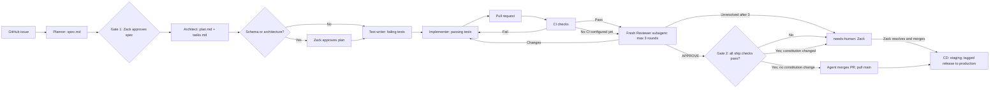

# Spec-driven workflow

For each feature, use one GitHub issue, one `feature/NNN-name` branch, and one feature directory `docs/specs/NNN-name/`. [Constitution](constitution.md) and [product spec](spec.md) govern all steps; [roles](agents/) define handoffs.

## Durable handoffs

Before starting or resuming any step, follow [work tracking](work/README.md).
The coordinator links each independently owned assignment from feature tasks to
a local ticket and records actual agents in the run roster before handing off.
Local records supplement the required issue; no external project board is used.
Workers checkpoint results in their tickets; the coordinator handles read-only
workers and fresh Reviewers without broadening their permitted inputs.

Ship coordinators use the same recovery procedure before repeating PR operations,
review dispatches, or merges. Before dispatch, the ticket records the reviewed
revision and remaining ship step. Later checkpoints use factual PR comments and
Agent Flow without creating tracking-only branches. [Ship](skills/ship.md)
remains the merge authority; an in-memory plan or chat summary alone is not a
completed handoff.

## Feature delivery

0. **Worktree:** Create an isolated worktree: `git worktree add ../tallyhold-NNN-name -b feature/NNN-name` (or `chore/name` for maintenance). All subsequent steps in this feature run from that worktree directory. After the branch merges (Step 11), run `git worktree remove ../tallyhold-NNN-name` from the main worktree and delete the local branch.
1. **Issue:** Zack describes a feature and constraints on GitHub.
2. **Planner:** Draft `spec.md` from the issue with user stories, Given/When/Then criteria, out-of-scope items and open questions.
   On Zack's request, use [grill-me](../.claude/skills/grill-me/SKILL.md) to resolve Draft-spec questions before Gate 1; only Zack approves.
3. **Gate 1:** Zack explicitly approves the spec; set Status to Approved. Do not plan or implement a Draft spec.
4. **Architect:** Write `plan.md` (files, layers, classes, interfaces, migrations and tests) and ordered `tasks.md`; record significant decisions as ADRs. For schema or architecture changes, Zack approves the plan before tests or implementation.
5. **Test writer:** On the feature branch, commit failing pytest tests mapped to criteria; confirm failures are caused by missing behavior.
6. **Implementer:** Complete and commit tasks one at a time using Conventional Commits. Run targeted and full checks; never alter tests just to pass.
   Use [tdd](../.claude/skills/tdd/SKILL.md) across the RED Test writer handoff and the GREEN/REFACTOR Implementer work, in separate commits.
7. **PR:** On "create pr", "open pr", "ship" or "ship it", follow [ship](skills/ship.md) end to end. Its [create-pr](skills/create-pr.md) sub-step opens the PR linking the issue and approved spec.
8. **CI:** Run backend ruff lint/format, mypy, pytest with >=80% overall coverage, migration check against fresh Postgres when migrations exist, frontend lint/type check/build, and dependency vulnerability scan. CI failures return to implementation.
9. **Reviewer:** Follow [ship](skills/ship.md) step 4: a brand-new subagent reviews the PR diff with only the permitted evidence and posts `review.md` plus an identical PR comment. Each round uses a new subagent; Implementer fixes findings, at most three rounds before escalating to Zack.
10. **Gate 2 (ship merge):** After a fresh Reviewer approves with no must-fix or should-fix findings, the coordinator checks local results, CI (or confirms no CI yet), labels and the constitution diff, then merges via [ship](skills/ship.md). If any condition fails, label `needs-human`, comment why and report to Zack. Zack alone merges PRs modifying `docs/constitution.md`.
11. **CD:** Deploy staging after merge; deploy production on a tagged release. Hosting remains undecided in the [product spec](spec.md#open-questions).
    On request or at a build phase end, Architect may use [improve-codebase-architecture](../.claude/skills/improve-codebase-architecture/SKILL.md) for read-only findings and feature proposals.

Suggested tool assignment: Claude Code CLI for Planner, Architect and Reviewer; Trae for Test writer and Implementer. This keeps the reviewing model different from the coding model. DevOps can use either tool, on the feature's branch during its exclusive turn.

Git is the only sync between devices: pull before starting, push when stopping. Only one tool may work on a given branch at a time; multiple branches in separate worktrees may run concurrently. Hand off by pushing and then pulling on the other device. Never run both tools on the same branch concurrently. Zack owns Gate 1, required plan approvals and merges of constitution-changing PRs.

