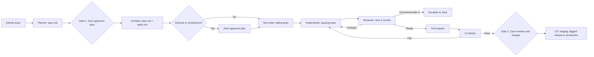

# Spec-driven workflow

For each feature, use one GitHub issue, one `feature/NNN-name` branch, and one feature directory `docs/specs/NNN-name/`. [Constitution](constitution.md) and [product spec](spec.md) govern all steps; [roles](agents/) define handoffs.

1. **Issue:** Zack describes a feature and constraints on GitHub.
2. **Planner:** Draft `spec.md` from the issue with user stories, Given/When/Then criteria, out-of-scope items and open questions.
   On Zack's request, use [grill-me](../.claude/skills/grill-me/SKILL.md) to resolve Draft-spec questions before Gate 1; only Zack approves.
3. **Gate 1:** Zack explicitly approves the spec; set Status to Approved. Do not plan or implement a Draft spec.
4. **Architect:** Write `plan.md` (files, layers, classes, interfaces, migrations and tests) and ordered `tasks.md`; record significant decisions as ADRs. For schema or architecture changes, Zack approves the plan before tests or implementation.
5. **Test writer:** On the feature branch, commit failing pytest tests mapped to criteria; confirm failures are caused by missing behavior.
6. **Implementer:** Complete and commit tasks one at a time using Conventional Commits. Run targeted and full checks; never alter tests just to pass.
   Use [tdd](../.claude/skills/tdd/SKILL.md) across the RED Test writer handoff and the GREEN/REFACTOR Implementer work, in separate commits.
7. **Reviewer:** Independently review the diff against spec, plan, constitution and security; record must-fix / should-fix / nit in `review.md`. Implementer addresses findings; repeat at most three rounds, then escalate to Zack.
8. **PR:** An agent follows [create-pr](skills/create-pr.md) to open a PR linking the issue and approved spec. Keep it limited to this feature.
9. **CI:** Run backend ruff lint/format, mypy, pytest with >=80% overall coverage, migration check against fresh Postgres when migrations exist, frontend lint/type check/build, and dependency vulnerability scan. CI failures return to implementation and review.
10. **Gate 2:** Zack reviews the PR and any Alembic migrations, then merges. Agents never push to `main` or merge.
11. **CD:** Deploy staging after merge; deploy production on a tagged release. Hosting remains undecided in the [product spec](spec.md#open-questions).
    On request or at a build phase end, Architect or Reviewer may use [improve-codebase-architecture](../.claude/skills/improve-codebase-architecture/SKILL.md) for read-only findings and feature proposals.

Suggested tool assignment: Claude Code CLI for Planner, Architect and Reviewer; Trae for Test writer and Implementer. This keeps the reviewing model different from the coding model. DevOps can use either tool, on the feature's branch during its exclusive turn.

Git is the only sync between devices: pull before starting, push when stopping. Only one tool may work on a branch at a time; hand off by pushing and then pulling on the other device. Never run both tools on the same branch concurrently. Zack owns both approvals and the merge.

